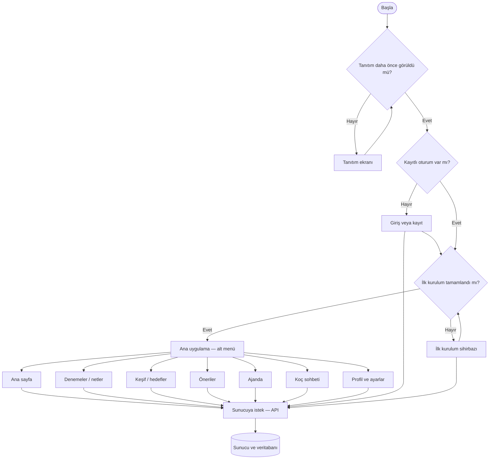

# Şekil — kAIzen uygulaması iş akış diyagramı

Aşağıdaki diyagram, klasik **Başla → karar → işlem → veri katmanı** düzenindedir (örnekteki “Cebimde Hizmet” şemasıyla aynı *tarz*; iş kuralları farklıdır: bizde işletme / hizmet veren rolü yoktur).



## Referans şemasından farklar (kısa)

| Örnek uygulama (görsel) | kAIzen |
|-------------------------|--------|
| İki rol: kullanıcı / işletme | Tek kullanıcı rolü; işletme paneli yok |
| Firebase | Veri ve oturum mantığı **backend + ilişkisel veritabanı** (ve gerekirse önbellek) üzerinden |
| “Randevu / ilan” modülleri | YKS odaklı modüller: deneme, öneri, ajanda, koç vb. |

## Önizleme

` ```mermaid ` … ` ``` ` bloğunu Mermaid Chart veya Markdown önizlemesi ile aç.
